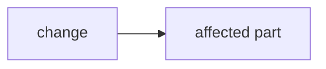

<!--
PR description format for this repo. Keep the ## headings in this order, and keep each section terse.
Delete a section only when it does not apply (Fix is for bug fixes only).
Title: a conventional commit, `type(scope): subject`.
The Diagram and File walkthrough sections are written by the PR author: PR-Agent's own copies are
turned off (enable_pr_diagram, enable_semantic_files_types in .pr_agent.toml). PR-Agent still appends
PR Type and its AI summary below this description (auto_describe in .github/workflows/pr-agent.yml).
.pr_agent.toml ([pr_description] extra_instructions) lists the same headings; keep the two in sync.
-->

## Summary

<!-- 1-2 lines: what changed and why. -->

## What changed

<!-- Bullets, by key file or module. -->

-

## Diagram

<!-- A small mermaid flowchart of how the change fits together: the pieces it adds or changes and how
they connect. Keep it under about 10 nodes. -->

## File walkthrough

<!-- One row per changed file: what changed in it, and its +/- lines (git diff --stat main...HEAD). -->

File walkthrough

| File | Change | +/- |
|---|---|---|
| `path/to/file` | What changed in it | +0 / -0 |

## Problem / feature

<!-- The bug being fixed, or the feature delivered. -->

## Fix

<!-- Bug fixes only: the root cause and how it was fixed. Delete this section otherwise. -->

## Test plan

<!-- A checklist, manual and automated. Tick what ran; say what did not run and why. -->

- [ ] `node --test tests/viewer/`
- [ ] `cargo fmt --check`, `cargo clippy --all-targets -- -D warnings`, `cargo test` (in `src-tauri/`)
- [ ] Manual check in the running app (`cd src-tauri && cargo run`)

## Deployment steps

<!-- Migrations, env vars, secrets, restarts. "None" if pure code. -->

None.

## Verification

<!-- Gate status: which gates ran and their results. -->
